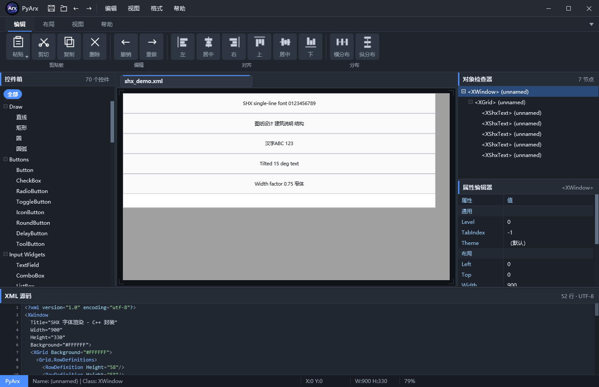

# PyArx

AutoCAD（ObjectArx）+ MFC/XML 的 Python 绑定与控件库。C++ 侧用 pybind11 暴露成 Python 模块，界面层用 MFC 承载一套自绘控件库，XML 只做声明式布局与事件绑定。

**一句话**：给 AutoCAD 二次开发一套「Python 写逻辑、XML 写界面」的桌面 UI 方案——自带 50+ MFC 自绘控件、可视化 UI 设计器（拖控件、改属性、所见即所得）和独立预览器。

**关键词**：AutoCAD 二次开发 · ObjectArx · pybind11 · Python 3.15 · free-threaded · 无 GIL · MFC · XML · 可视化 UI 设计器 · 自绘控件库 · 声明式界面 · 桌面 GUI 框架 · AutoCAD plugin · CAD automation

仓库地址：

- GitHub（主镜像）：https://github.com/fengyeqiyu/PyArx
- Gitee（国内镜像）：https://gitee.com/fengyeqiyu/PyArx

## 这个项目能做什么

- **Python 调 CAD**：pybind11 把 ObjectArx 2024 的类库（数据库、实体、事务、选择集）暴露成 Python 模块，写业务逻辑不用碰 C++。
- **XML 写界面**：界面用声明式标签描述（`<XButton>`、`<XGrid>`、`<XStackPanel>` …），事件回 Python 函数（`on_click="fn"`），控件名直接当属性用（`c.BtnApply`）。
- **可视化设计器**：`UIDesign.exe` 打开 `designer_layout.xml` 做壳，画布拖放控件、属性表改值、对象树看层级、XML 代码坞同步，改完直接跑。
- **一致的双端渲染**：设计器画布、独立预览器、运行时用同一批 C++ 绘制函数，避免“设计器好看、跑起来不一样”。

## 项目简介

PyArx 是一个将 AutoCAD 的 ObjectArx 框架与 MFC/XML UI 技术桥接到 Python 的开发库。通过 pybind11 实现 C++ 到 Python 的绑定，结合自绘 MFC 控件库和 XML 声明式 UI，实现 CAD 二次开发中的现代化界面开发能力。

### 核心特性

- **Python 绑定**：使用 pybind11 将 ObjectArx 核心类库暴露为 Python 模块
- **自绘控件库**：基于 MFC 的完全自绘控件，支持皮肤定制
- **XML 布局**：支持 XML 声明式 UI 定义，配合 Python 事件回调

## 界面截图

可视化设计器：左侧控件箱（70 个控件）、中间设计画布、右侧对象检查器与属性编辑器、底部 XML 源码同步。



同一套布局可以用 XML 标签写，也可以用 HTML/CSS 写，两条路径走同一批 C++ 绘制函数，渲染结果一致（一致性由 `tests/xml_ui` 回归保证）。

## 目录结构

| 目录 | 说明 |
|------|------|
| `PyArxCore` | ObjectArx 核心封装，包含 Python 模块入口、CAD 数据库交互、实体对象、事务管理等 |
| `PyArxEngine` | AutoCAD `.arx` 入口：在 CAD 进程内加载 Python 运行时、注册命令、把命令派发给 PyArxCore |
| `MfcXmlCore` | XML 解析引擎、控件库（controls\Xml*.h/.cpp）、属性表（XmlTypes.h）、事件契约（XmlEvents.h） |
| `PyMfcXml` | MFC 宿主程序，包含窗口管理、皮肤自绘、事件派发（PyMfcHost / PyMfcProcs / PyMfcLoad） |
| `MfcXmlRuntime` | 复合控件运行框架（Python 实现） |
| `UIDesign` | UI 设计器 |
| `Viewer` / `XmlViewer` | 预览工具 |
| `plugins` | 用 XML 组合的复合控件（通用组合下沉到 C++ 基础控件） |
| `tests` | 回归测试脚本（tests\mfc_xml 下按控件/交互分类） |
| `tools` | 维护脚本：`declsplit.py` 类体切分、`git_tag_version.ps1` 打版本号标签 |
| `docs` | 设计文档、评审记录、执行记录 |
| `res` | 运行时资源（图标、光标等） |

> **注意**：`third_party`（pybind11 / zlib / python315t 等）与构建产物 `X64` 不入库，按需自行准备。

## 构建说明

### 环境要求

- Windows 64 位系统
- Visual Studio / MSBuild
- Python 3.15：默认 free-threaded（3.15t，`python315t.dll`）；GIL 版 3.15（`python315.dll`）同样可用，源码按 `Py_GIL_DISABLED` 自动选择 `python315t.lib` / `python315.lib`
- ObjectArx SDK 2024

### 构建命令

```bash
MSBuild PyArx.sln /t:PyMfcXml /p:Configuration=Release /p:Platform=x64
```

### 构建产物

- 输出目录：`X64\Release`
- 主要产物：
  - `PyArxCore.pyd` - CAD 绑定模块（在 AutoCAD 进程内加载）
  - `PyArxEngine.arx` / `PyArxEngine.dll` - CAD 入口、命令注册与派发
  - `PyMfcXml.pyd` - MFC 宿主模块（Python 可导入）
  - `MfcXmlCore.dll` - 基础控件库（含 `MfcXmlFrame` 静态库）；`MfcXmlRuntime` 为复合控件运行时（Python 侧）
  - `python315t.dll` 等运行时依赖 - Python 3.15 free-threaded，需随产物一起分发

> **注意**：`res` 目录不随构建自动拷贝，修改资源后需手工复制到产物目录。

## 设计约定

### 属性系统

控件属性统一走 `XmlPropEntry` 属性表：
- 名字、类型、只读/只写属性
- 读写实现只在一处定义
- 基类统一分派机制

### 事件系统

事件走 `XmlEvents.h` 的契约表：
- XML 端只写事件名
- 控件申报 `events()` 方法
- 宿主按契约绑定并派发

### 回调机制

- Python 回调：XML 里写 `on_click="fn"`，或加载后 `child.click = fn`
- 控件事件通过契约表统一管理

### 控件层级

- **C++ 层**：只提供基础控件
- **XML 层**：复合控件用 XML 组合，放在 `plugins` 目录
- 确认通用后下沉到 C++ 层

## 核心模块说明

### PyArxCore

ObjectArx 核心 Python 绑定，包含：
- 数据库操作（PyDbDatabase、事务管理）
- 实体对象（线、圆、多段线、尺寸标注、块引用等）
- 符号表（图层、线型、块表等）
- 选择集与过滤
- 反应器（数据库反应器、对象反应器）
- 侧栏（CAdUiPaletteSet / CAdUiPalette），页内控件宿主由 GUI 层回填

### PyArxEngine

AutoCAD ARX 入口与 Python 运行时宿主：
- 加载 `PyArxEngine.arx` 后注册命令：`PYLOAD` / `PYRUN` / `PYRUNFILE` / `PYEXEC` / `PYDEBUG` / `PIPM` / `PYARXDEPLOY`
- 首次执行命令时按需初始化 Python 引擎，运行时 dll 按 `Py_GIL_DISABLED` 选择 `python315t.dll`（free-threaded）/ `python315.dll`
- 执行结果与错误回显到 CAD 命令行；初始化细节写入 `pyengine.log`

### MfcXmlCore

XML 解析与控件系统：
- XmlCore：XML 解析、布局、样式、模板、绑定表达式
- 控件库：Button、TextBox、ListBox、TreeView、GridView、TableView 等
- 自绘皮肤：ProgressBar、Slider、Combo、Tab、Calendar、Menu 等
- 几何引擎：基于 Boost.Geometry 的几何计算
- SVG 支持：nanosvg 实现的 SVG 渲染
- D3D11 渲染：Direct3D 11 后端渲染

### MfcXmlRuntime

复合控件运行框架（Python 实现）：
- Composite：复合控件容器
- Runtime：控件运行时管理
- 自动事件绑定与属性映射

## 运行时与依赖

- 目标 Python 为 3.15 free-threaded（无 GIL，`python315t.dll`）；GIL 版 `python315.dll` 走同一套源码。
- `python315t.lib` / `python315.lib` 由 `Py_GIL_DISABLED` 决定，源码中不硬编码单一 dll 名。
- 模块入口用 `PYBIND11_MODULE(..., py::mod_gil_not_used())` 声明，free-threaded 下可直接调用。
- 打包分发时把 `python315t.dll` 及其依赖（`python3t.dll`、`libffi-8.dll` 等）与 `PyArxCore.pyd` / `PyArxEngine.arx` / `PyMfcXml.pyd` 放同一目录；依赖链可 `dumpbin /DEPENDENTS` 复核。

## 版本与分支约定

- `master` 永远是最新代码，所有提交直接落在 `master` 上；历史版本不靠分支保存，靠 **tag** 固定。
- 每个提交对应一个 `v主.次.补丁` 标签，标签信息即提交主题，随时 `git checkout v0.9.0` 或 `git show v0.9.0` 回看那一版。
- 递增规则（由脚本自动执行）：
  - 提交主题以 `feat` / `refactor` 开头，或属于控件封装批次 → 次版本 +1、补丁归零
  - 其余（`fix` / `chore` / `build` / `docs` / `test`、网页端改 README 等）→ 补丁 +1
  - 主题含 `BREAKING` → 主版本 +1、次版本与补丁归零
- 打标签：`.\tools\git_tag_version.ps1`（`-DryRun` 只看版本号，`-Push` 打标并推送，需 `$env:GITEE_TOKEN`）。

## 许可

MIT License，见 `LICENSE` 文件（Copyright (c) 2023 陈辉）。
